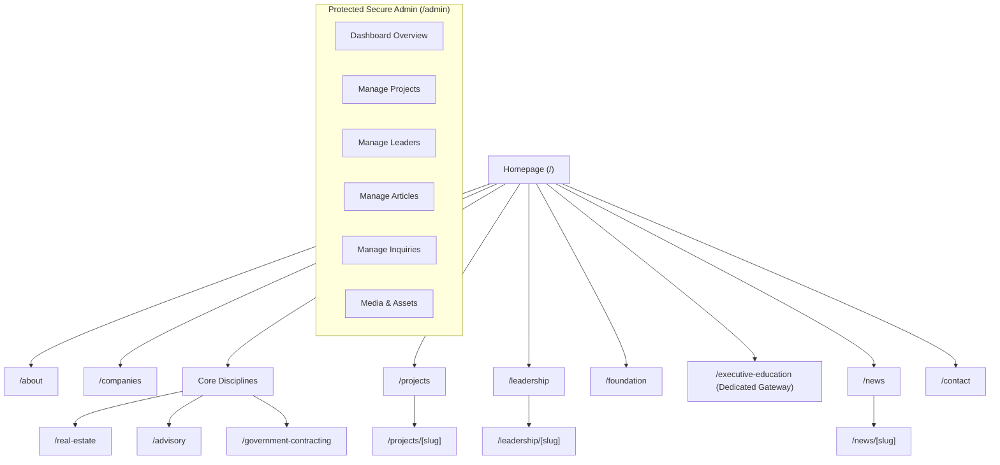

# JUBOH Companies International — Architecture & Sitemap

**Navigation Standard:** Clean, institutional, enterprise-first hierarchy (PDF p. 7). Avoid buzzwords or complex multi-level mega-menus. Every navigation item maps directly to a concrete, server-rendered Next.js route.

---

## 1. Global Navigation Scheme

### 1.1 Primary Desktop Navigation (Header Center / Left)
1. **About** → `/about`
2. **Companies** → `/companies`
3. **Real Estate** → `/real-estate`
4. **Advisory** → `/advisory`
5. **Government Contracting** → `/government-contracting`
6. **Projects** → `/projects`
7. **Leadership** → `/leadership`
8. **Foundation** → `/foundation`
9. **News** → `/news`

### 1.2 Primary Action (Header Far Right)
- **Start a Conversation** (or **Contact**) → `/contact`

### 1.3 Utility Navigation (Subtle / Top-Bar / Mobile Drawer Secondary)
- **Executive Education** → `/executive-education` (distinct program portal)
- **Client Portal** → `/client-portal` (discreet login gateway)
- **Search / Directory** (optional modal when index exists)

---

## 2. Comprehensive Route Map

```
app/
├── (site)/
│   ├── page.tsx                           # Homepage (Cinematic Hero + Enterprise Disciplines)
│   ├── about/
│   │   └── page.tsx                       # Enterprise Overview, Mission, Values, History
│   ├── companies/
│   │   └── page.tsx                       # Enterprise Operating Units & Business Disciplines
│   ├── real-estate/
│   │   └── page.tsx                       # Master-Development, Asset Classes, Methodology
│   ├── advisory/
│   │   └── page.tsx                       # Business Strategy, Capital Advisory, Institutional Practice
│   ├── government-contracting/
│   │   └── page.tsx                       # Public-Sector Delivery, Compliance, Capabilities
│   ├── projects/
│   │   ├── page.tsx                       # Filterable Portfolio Index (Real Estate & Infrastructure)
│   │   └── [slug]/
│   │       └── page.tsx                   # Individual Architectural Project Case Study
│   ├── leadership/
│   │   ├── page.tsx                       # Leadership Index & Governance Overview
│   │   └── [slug]/
│   │       └── page.tsx                   # Executive Biography & Operating Responsibilities
│   ├── foundation/
│   │   └── page.tsx                       # Philanthropy, Community Impact & Civic Initiatives
│   ├── executive-education/
│   │   └── page.tsx                       # Leadership Academies, Cohorts & Executive Programs
│   ├── news/
│   │   ├── page.tsx                       # Corporate Insights, Press Releases & Announcements
│   │   └── [slug]/
│   │       └── page.tsx                   # Full Article Reading Experience
│   ├── contact/
│   │   └── page.tsx                       # Enterprise Inquiries, Office Locations, Validated Form
│   ├── privacy/
│   │   └── page.tsx                       # Privacy Policy (Draft / Client Legal Review)
│   └── terms/
│       └── page.tsx                       # Terms of Service (Draft / Client Legal Review)
│
├── (admin)/
│   └── admin/
│       ├── page.tsx                       # Secure CMS Dashboard
│       ├── projects/page.tsx              # Projects CRUD & Gallery Manager
│       ├── leaders/page.tsx               # Leadership Profiles & Approvals
│       ├── articles/page.tsx              # News, Insights & Press Management
│       ├── areas/page.tsx                 # Operating Disciplines / Companies Manager
│       ├── inquiries/page.tsx             # Enterprise Contact Inquiries Log
│       ├── media/page.tsx                 # Media Asset Library & Focal-Point Editor
│       └── settings/page.tsx              # Brand Metadata & Contact Info Settings
│
└── not-found.tsx                          # Tailored 404 Institutional Page
```

---

## 3. Structural Information Hierarchy


